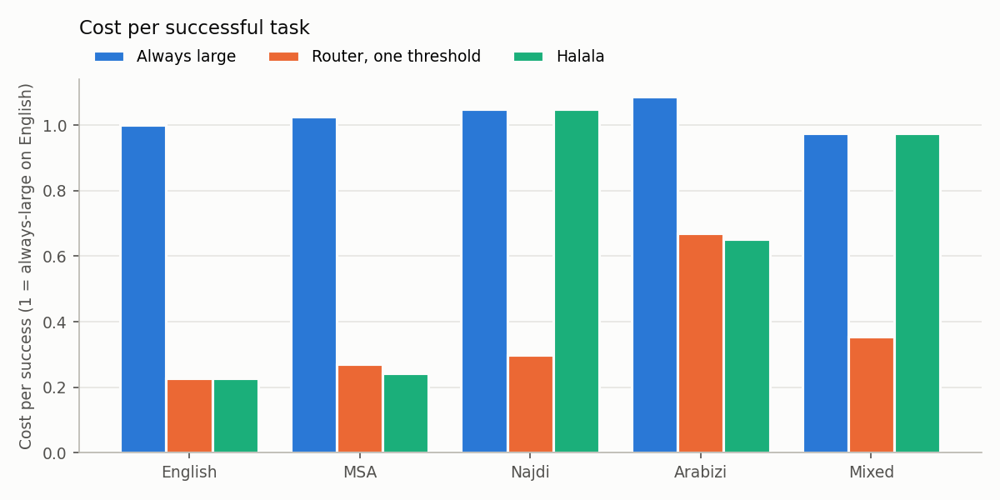
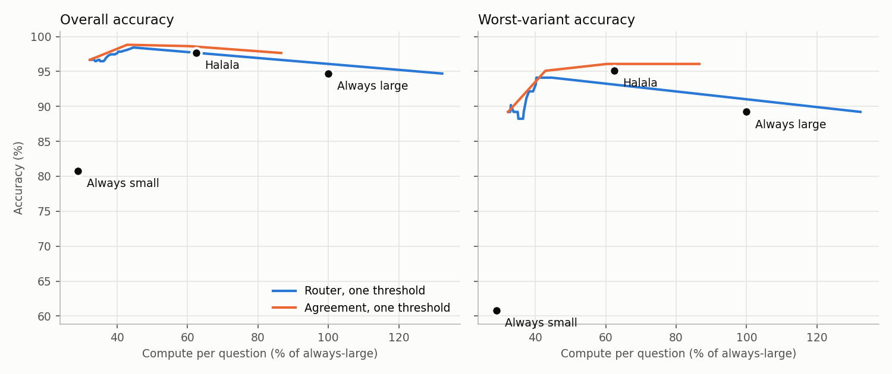
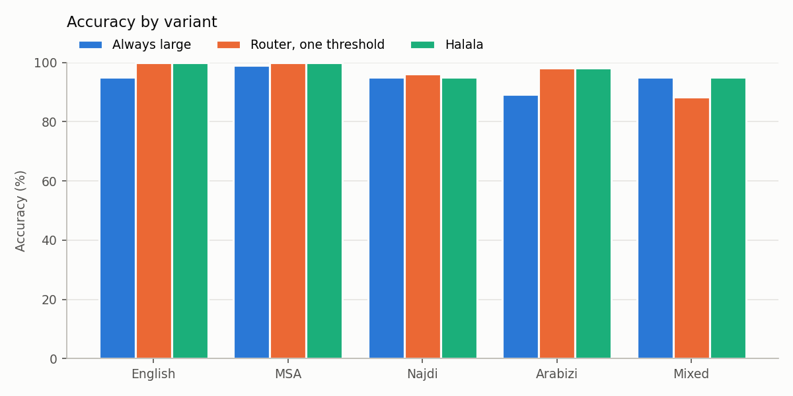

### Run `default`: test split, 510 items

Small model `mock-small`, large model `mock-large`. Cost is estimated FLOPs, shown relative to always using the large model.

**Mock models.** These numbers only check that the pipeline works. They are not results.

Floors: every variant at 80% success or better, and a task only succeeds if answered within 30.0 seconds.

| Policy | Accuracy | Worst variant vs always-large | Cost per success vs always-large | Cost vs always-large | Sent to large model | p95 latency | Meets floors |
|---|---|---|---|---|---|---|---|
| Always small | 80.8% | -34.3 pts (Mixed) | 34% | 29% | 0% | 0.1s | no |
| Always large | 94.7% | 0.0 pts (English) | 100% | 100% | 100% | 0.2s | yes |
| Agreement, one threshold | 98.8% | 0.0 pts (Mixed) | 41% | 43% | 11% | 0.4s | yes |
| Router, one threshold | 96.5% | -6.9 pts (Mixed) | 35% | 36% | 4% | 0.3s | yes |
| Halala: router, per-variant thresholds | 97.6% | 0.0 pts (Najdi) | 61% | 62% | 40% | 0.3s | yes |
| Halala + answer cache | 97.6% | 0.0 pts (Najdi) | 61% | 62% | 40% | 0.3s | yes |

#### Accuracy by variant

| Variant | Always small | Always large | Router, one threshold | Halala: router, per-variant thresholds | Halala: sent to large |
|---|---|---|---|---|---|
| English | 93.1% | 95.1% | 100.0% | 100.0% | 0% |
| MSA | 91.2% | 99.0% | 100.0% | 100.0% | 0% |
| Najdi | 73.5% | 95.1% | 96.1% | 95.1% | 100% |
| Arabizi | 85.3% | 89.2% | 98.0% | 98.0% | 0% |
| Mixed | 60.8% | 95.1% | 88.2% | 95.1% | 100% |

#### Cost per successful task, by variant

1.0x is always-large on English. Failed tasks still count as spend, so a variant that fails often costs more per success.

| Variant | Always small | Always large | Router, one threshold | Halala: router, per-variant thresholds |
|---|---|---|---|---|
| English | 0.2x | 1.0x | 0.2x | 0.2x |
| MSA | 0.2x | 1.0x | 0.3x | 0.2x |
| Najdi | 0.3x | 1.0x | 0.3x | 1.0x |
| Arabizi | 0.7x | 1.1x | 0.7x | 0.7x |
| Mixed | 0.3x | 1.0x | 0.4x | 1.0x |

#### Guarantee check (epsilon = 0.05, delta = 0.1)

Loss is the share of questions Halala got wrong that the large model got right. Thresholds are set per detected variant; this table groups by the dataset's variant labels.

| Variant | Loss on test | Within epsilon |
|---|---|---|
| English | 0.0% | yes |
| MSA | 0.0% | yes |
| Najdi | 0.0% | yes |
| Arabizi | 2.0% | yes |
| Mixed | 0.0% | yes |

