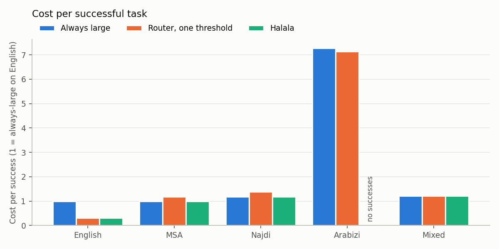
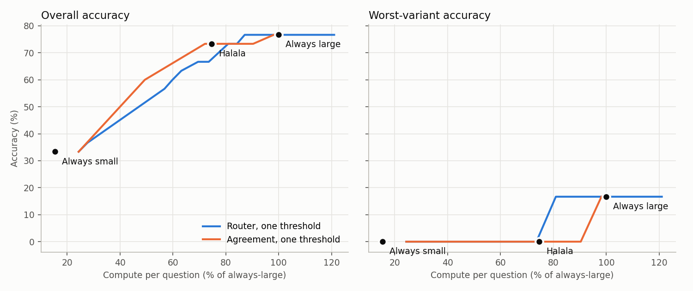
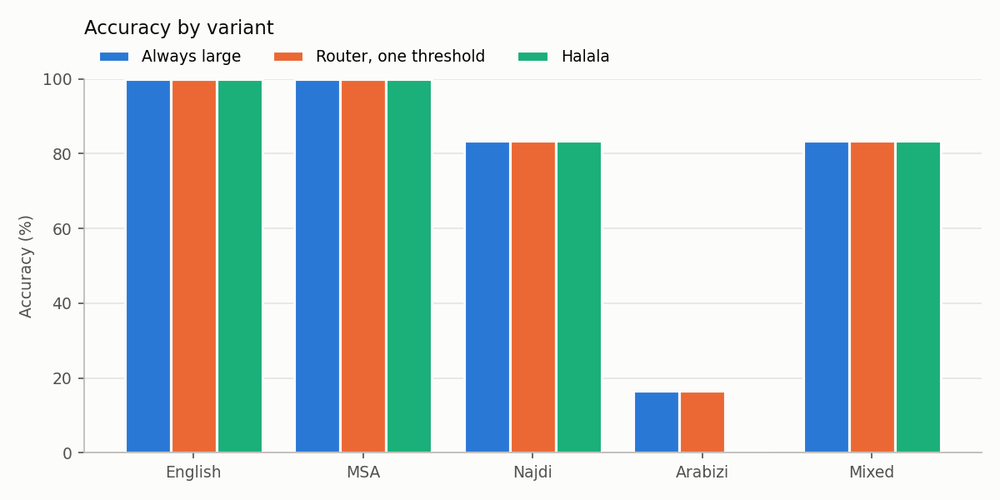

### Run `local`: test split, 30 items

Small model `qwen2.5:1.5b`, large model `allam-7b-q4`. Cost is estimated FLOPs, shown relative to always using the large model.

Floors: every variant at 80% success or better, and a task only succeeds if answered within any seconds.

| Policy | Accuracy | Worst variant vs always-large | Cost per success vs always-large | Cost vs always-large | Sent to large model | p95 latency | Meets floors |
|---|---|---|---|---|---|---|---|
| Always small | 33.3% | -83.3 pts (MSA) | 36% | 15% | 0% | 9.6s | no |
| Always large | 76.7% | 0.0 pts (English) | 100% | 100% | 100% | 15.2s | no |
| Agreement, one threshold | 73.3% | -16.7 pts (Arabizi) | 94% | 90% | 70% | 49.6s | no |
| Router, one threshold | 76.7% | 0.0 pts (English) | 94% | 94% | 73% | 49.6s | no |
| Halala: router, per-variant thresholds | 73.3% | -16.7 pts (Arabizi) | 78% | 75% | 63% | 48.4s | no |
| Halala + answer cache | 73.3% | -16.7 pts (Arabizi) | 78% | 75% | 63% | 48.4s | no |

#### Accuracy by variant

| Variant | Always small | Always large | Router, one threshold | Halala: router, per-variant thresholds | Halala: sent to large |
|---|---|---|---|---|---|
| English | 100.0% | 100.0% | 100.0% | 100.0% | 17% |
| MSA | 16.7% | 100.0% | 100.0% | 100.0% | 100% |
| Najdi | 16.7% | 83.3% | 83.3% | 83.3% | 100% |
| Arabizi | 0.0% | 16.7% | 16.7% | 0.0% | 17% |
| Mixed | 33.3% | 83.3% | 83.3% | 83.3% | 83% |

#### Cost per successful task, by variant

1.0x is always-large on English. Failed tasks still count as spend, so a variant that fails often costs more per success.

| Variant | Always small | Always large | Router, one threshold | Halala: router, per-variant thresholds |
|---|---|---|---|---|
| English | 0.1x | 1.0x | 0.3x | 0.3x |
| MSA | 0.7x | 1.0x | 1.2x | 1.0x |
| Najdi | 0.7x | 1.2x | 1.4x | 1.2x |
| Arabizi | no successes | 7.3x | 7.1x | no successes |
| Mixed | 0.4x | 1.2x | 1.2x | 1.2x |

#### Guarantee check (epsilon = 0.1, delta = 0.1)

Loss is the share of questions Halala got wrong that the large model got right. Thresholds are set per detected variant; this table groups by the dataset's variant labels.

| Variant | Loss on test | Within epsilon |
|---|---|---|
| English | 0.0% | yes |
| MSA | 0.0% | yes |
| Najdi | 0.0% | yes |
| Arabizi | 16.7% | no |
| Mixed | 0.0% | yes |

