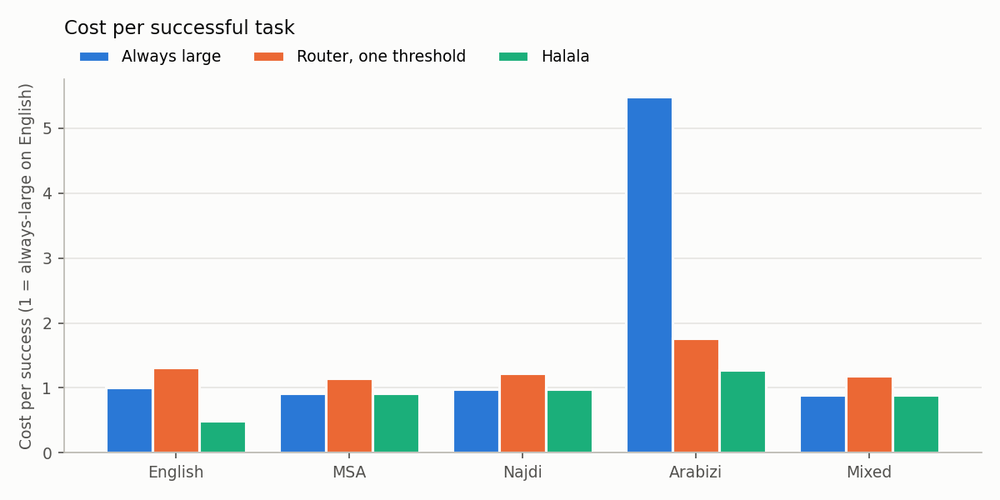
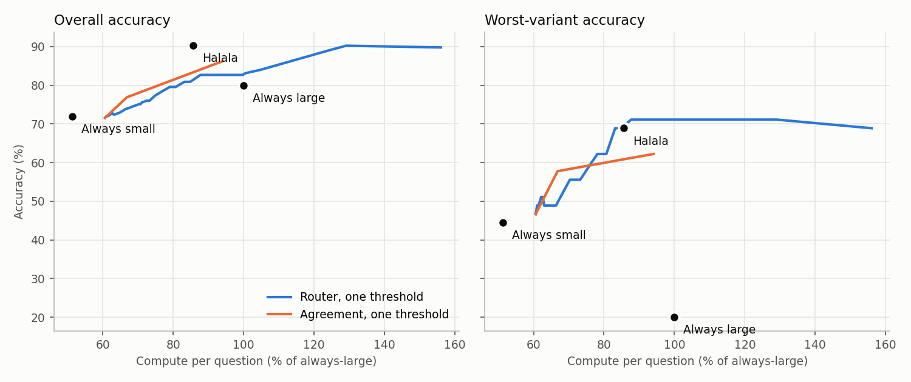
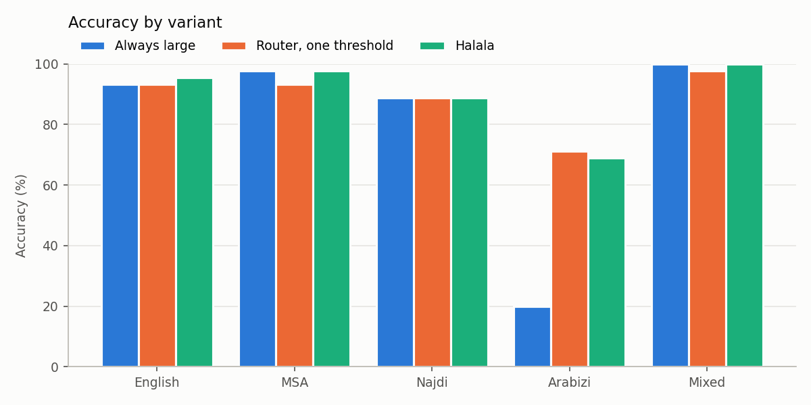

### Run `local_gemma`: all dev questions, 225 items

Small model `gemma3:4b`, large model `allam-7b-q4-inst`. Cost is estimated FLOPs, shown relative to always using the large model.

The router and thresholds were fitted on most of these questions, so their rows are optimistic. Halala has no trained parts.

Floors: every variant at 80% success or better, and a task only succeeds if answered within any seconds.

| Policy | Accuracy | Worst variant vs always-large | Cost per success vs always-large | Cost vs always-large | Sent to large model | p95 latency | Meets floors |
|---|---|---|---|---|---|---|---|
| Always small | 72.0% | -28.9 pts (Mixed) | 57% | 51% | 0% | 3.2s | no |
| Always large | 80.0% | 0.0 pts (English) | 100% | 100% | 100% | 5.4s | no |
| Agreement, one threshold | 89.8% | 0.0 pts (English) | 85% | 95% | 100% | 4.7s | no |
| Router, one threshold | 88.9% | -4.4 pts (MSA) | 111% | 124% | 66% | 14.1s | no |
| Full pipeline: router, per-variant thresholds | 90.2% | 0.0 pts (MSA) | 77% | 87% | 80% | 9.0s | no |
| Halala: English to small once, the rest large + rewrite | 90.2% | 0.0 pts (MSA) | 76% | 86% | 80% | 4.5s | no |
| Halala + answer cache | 90.2% | 0.0 pts (MSA) | 76% | 86% | 80% | 4.5s | no |

#### Accuracy by variant

| Variant | Always small | Always large | Router, one threshold | Full pipeline: router, per-variant thresholds | Halala: English to small once, the rest large + rewrite | Halala: sent to large |
|---|---|---|---|---|---|---|
| English | 95.6% | 93.3% | 93.3% | 95.6% | 95.6% | 0% |
| MSA | 80.0% | 97.8% | 93.3% | 97.8% | 97.8% | 100% |
| Najdi | 68.9% | 88.9% | 88.9% | 88.9% | 88.9% | 100% |
| Arabizi | 44.4% | 20.0% | 71.1% | 68.9% | 68.9% | 100% |
| Mixed | 71.1% | 100.0% | 97.8% | 100.0% | 100.0% | 100% |

#### Cost per successful task, by variant

1.0x is always-large on English. Failed tasks still count as spend, so a variant that fails often costs more per success.

| Variant | Always small | Always large | Router, one threshold | Full pipeline: router, per-variant thresholds | Halala: English to small once, the rest large + rewrite |
|---|---|---|---|---|---|
| English | 0.5x | 1.0x | 1.3x | 0.6x | 0.5x |
| MSA | 0.6x | 0.9x | 1.1x | 0.9x | 0.9x |
| Najdi | 0.7x | 1.0x | 1.2x | 1.0x | 1.0x |
| Arabizi | 1.1x | 5.5x | 1.8x | 1.3x | 1.3x |
| Mixed | 0.7x | 0.9x | 1.2x | 0.9x | 0.9x |

#### Full pipeline guarantee check (epsilon = 0.1, delta = 0.1)

Loss is the share of questions it got wrong that the large model got right. Thresholds are set per detected variant; this table groups by the dataset's variant labels.

| Variant | Loss on test | Within epsilon |
|---|---|---|
| English | 0.0% | yes |
| MSA | 0.0% | yes |
| Najdi | 0.0% | yes |
| Arabizi | 4.4% | yes |
| Mixed | 0.0% | yes |

