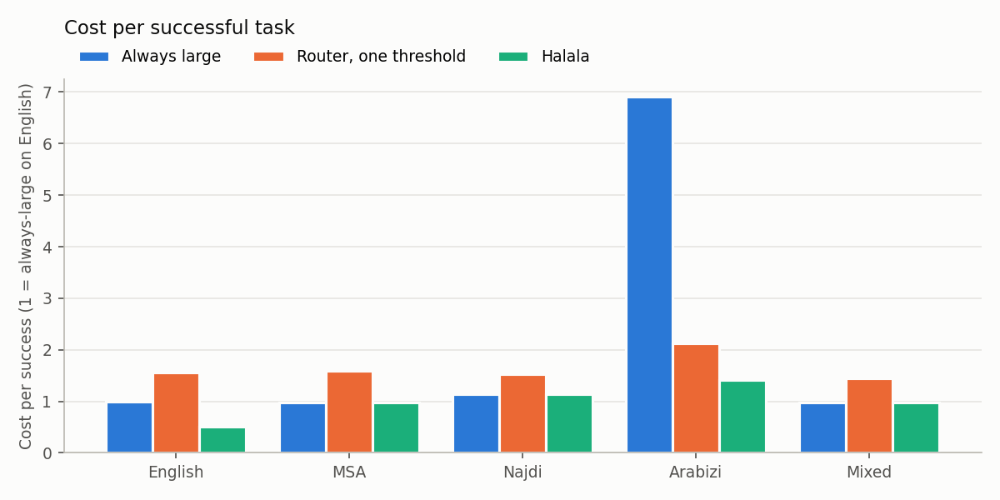
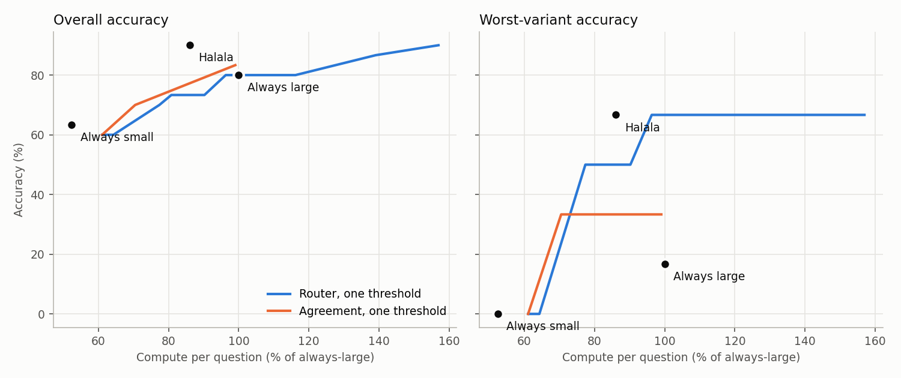
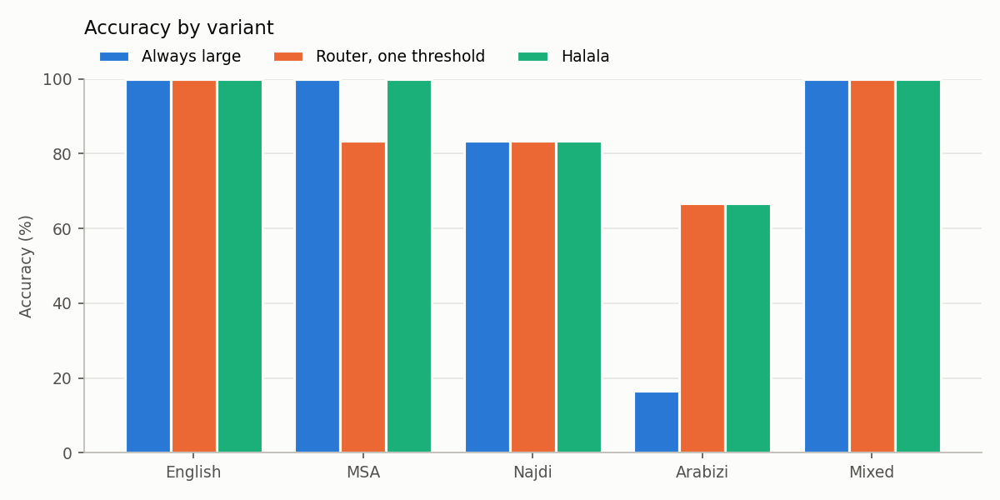

### Run `local_gemma`: test split, 30 items

Small model `gemma3:4b`, large model `allam-7b-q4-inst`. Cost is estimated FLOPs, shown relative to always using the large model.

Floors: every variant at 80% success or better, and a task only succeeds if answered within any seconds.

| Policy | Accuracy | Worst variant vs always-large | Cost per success vs always-large | Cost vs always-large | Sent to large model | p95 latency | Meets floors |
|---|---|---|---|---|---|---|---|
| Always small | 63.3% | -33.3 pts (Najdi) | 66% | 52% | 0% | 3.0s | no |
| Always large | 80.0% | 0.0 pts (English) | 100% | 100% | 100% | 4.0s | no |
| Agreement, one threshold | 90.0% | 0.0 pts (English) | 85% | 96% | 100% | 3.9s | no |
| Router, one threshold | 86.7% | -16.7 pts (MSA) | 128% | 139% | 80% | 13.5s | no |
| Full pipeline: router, per-variant thresholds | 90.0% | 0.0 pts (English) | 77% | 87% | 80% | 9.4s | no |
| Halala: English to small once, the rest large + rewrite | 90.0% | 0.0 pts (English) | 76% | 86% | 80% | 3.5s | no |
| Halala + answer cache | 90.0% | 0.0 pts (English) | 76% | 86% | 80% | 3.5s | no |

#### Accuracy by variant

| Variant | Always small | Always large | Router, one threshold | Full pipeline: router, per-variant thresholds | Halala: English to small once, the rest large + rewrite | Halala: sent to large |
|---|---|---|---|---|---|---|
| English | 100.0% | 100.0% | 100.0% | 100.0% | 100.0% | 0% |
| MSA | 83.3% | 100.0% | 83.3% | 100.0% | 100.0% | 100% |
| Najdi | 50.0% | 83.3% | 83.3% | 83.3% | 83.3% | 100% |
| Arabizi | 0.0% | 16.7% | 66.7% | 66.7% | 66.7% | 100% |
| Mixed | 83.3% | 100.0% | 100.0% | 100.0% | 100.0% | 100% |

#### Cost per successful task, by variant

1.0x is always-large on English. Failed tasks still count as spend, so a variant that fails often costs more per success.

| Variant | Always small | Always large | Router, one threshold | Full pipeline: router, per-variant thresholds | Halala: English to small once, the rest large + rewrite |
|---|---|---|---|---|---|
| English | 0.5x | 1.0x | 1.6x | 0.6x | 0.5x |
| MSA | 0.7x | 1.0x | 1.6x | 1.0x | 1.0x |
| Najdi | 1.1x | 1.1x | 1.5x | 1.1x | 1.1x |
| Arabizi | no successes | 6.9x | 2.1x | 1.4x | 1.4x |
| Mixed | 0.6x | 1.0x | 1.5x | 1.0x | 1.0x |

#### Full pipeline guarantee check (epsilon = 0.1, delta = 0.1)

Loss is the share of questions it got wrong that the large model got right. Thresholds are set per detected variant; this table groups by the dataset's variant labels.

| Variant | Loss on test | Within epsilon |
|---|---|---|
| English | 0.0% | yes |
| MSA | 0.0% | yes |
| Najdi | 0.0% | yes |
| Arabizi | 0.0% | yes |
| Mixed | 0.0% | yes |

