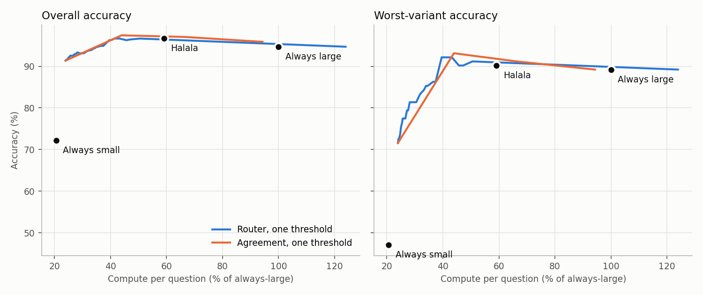
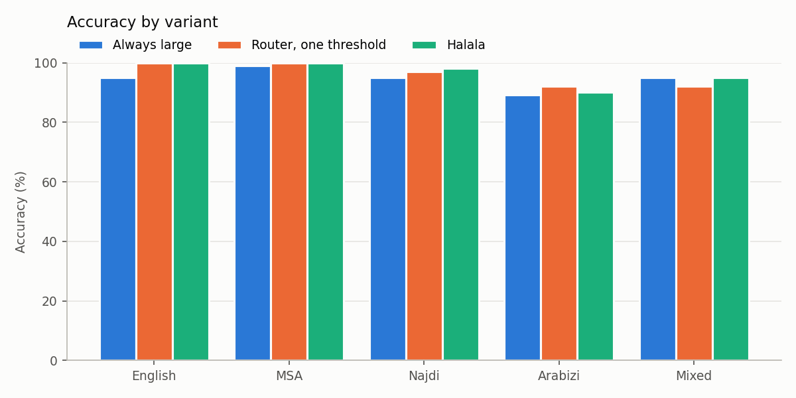

### Run `no_rescue`: test split, 510 items

Small model `mock-small`, large model `mock-large`. Cost is estimated FLOPs, shown relative to always using the large model.

**Mock models.** These numbers only check that the pipeline works. They are not results.

| Policy | Accuracy | Worst variant vs always-large | Cost vs always-large | Sent to large model |
|---|---|---|---|---|
| Always small | 72.2% | -42.2 pts (Arabizi) | 21% | 0% |
| Always large | 94.7% | 0.0 pts (English) | 100% | 100% |
| Agreement, one threshold | 97.5% | 0.0 pts (Mixed) | 44% | 20% |
| Router, one threshold | 96.3% | -2.9 pts (Mixed) | 41% | 17% |
| Halala: router, per-variant thresholds | 96.7% | 0.0 pts (Mixed) | 59% | 36% |
| Halala + answer cache | 96.7% | 0.0 pts (Mixed) | 59% | 36% |

#### Accuracy by variant

| Variant | Always small | Always large | Router, one threshold | Halala: router, per-variant thresholds | Halala: sent to large |
|---|---|---|---|---|---|
| English | 93.1% | 95.1% | 100.0% | 100.0% | 0% |
| MSA | 86.3% | 99.0% | 100.0% | 100.0% | 0% |
| Najdi | 73.5% | 95.1% | 97.1% | 98.0% | 15% |
| Arabizi | 47.1% | 89.2% | 92.2% | 90.2% | 66% |
| Mixed | 60.8% | 95.1% | 92.2% | 95.1% | 100% |

#### Guarantee check (epsilon = 0.05, delta = 0.1)

Loss is the share of questions Halala got wrong that the large model got right. Thresholds are set per detected variant; this table groups by the dataset's variant labels.

| Variant | Loss on test | Within epsilon |
|---|---|---|
| English | 0.0% | yes |
| MSA | 0.0% | yes |
| Najdi | 1.0% | yes |
| Arabizi | 1.0% | yes |
| Mixed | 0.0% | yes |

